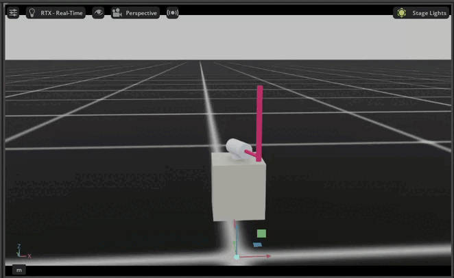
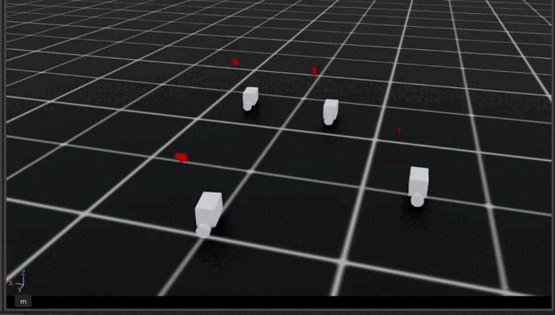

# 🚀 Isaac Lab Custom Assets

<p align="center">
  <b>Custom Assets for NVIDIA Isaac Sim / Isaac Lab</b><br>
  Mô phỏng robot · Reinforcement Learning · PPO Training · Control System · Robotics AI
</p>

<p align="center">
  
  
  
  
</p>

---

## 📌 Mục lục

- [1. Giới thiệu chung](#1-giới-thiệu-chung)
- [2. Link tải và tài liệu cài đặt](#2-link-tải-và-tài-liệu-cài-đặt)
- [3. Isaac Sim là gì?](#3-isaac-sim-là-gì)
- [4. Isaac Lab là gì?](#4-isaac-lab-là-gì)
- [5. Cấu trúc asset hiện tại](#5-cấu-trúc-asset-hiện-tại)
- [6. Vị trí đặt asset trong Isaac Lab](#6-vị-trí-đặt-asset-trong-isaac-lab)
- [7. Thêm asset vào `__init__.py`](#7-thêm-asset-vào-__init__py)
- [8. Test import asset](#8-test-import-asset)
- [9. Kiểm tra environment](#9-kiểm-tra-environment)
- [10. Lệnh train tổng quát](#10-lệnh-train-tổng-quát)
- [11. Lệnh play policy](#11-lệnh-play-policy)
- [12. Quy trình phát triển đề xuất](#12-quy-trình-phát-triển-đề-xuất)
- [13. Lỗi thường gặp](#13-lỗi-thường-gặp)
- [14. Rotary Inverted Pendulum](#14-rotary-inverted-pendulum)
- [15. Self-Balancing Robot](#15-self-balancing-robot)
- [16. Phần phát triển sau](#16-phần-phát-triển-sau)

---

## 1. Giới thiệu chung

Repository này chứa các **custom asset** được xây dựng để sử dụng trong **NVIDIA Isaac Sim** và **Isaac Lab**.

Mục tiêu của project là chuẩn bị các asset có thể tích hợp trực tiếp vào Isaac Lab để phục vụ cho:

- Mô phỏng hệ thống robot trong môi trường vật lý.
- Xây dựng môi trường Reinforcement Learning.
- Train policy điều khiển bằng PPO.
- Kiểm tra hành vi robot trong simulation.
- Phát triển thuật toán điều khiển trước khi triển khai thực nghiệm.

Ở giai đoạn đầu, README này tập trung vào phần **cài đặt, thêm asset và kiểm tra import**.  
Phần sau sẽ trình bày chi tiết hơn về từng hệ thống, bắt đầu với **Rotary Inverted Pendulum**.

---

## 2. Link tải và tài liệu cài đặt

Trước khi sử dụng asset trong repository này, cần cài đặt Isaac Sim và Isaac Lab đúng phiên bản tương thích.

| Nội dung | Link chính thức |
|---|---|
| NVIDIA Isaac Sim | [https://developer.nvidia.com/isaac/sim](https://developer.nvidia.com/isaac/sim) |
| Isaac Sim GitHub | [https://github.com/isaac-sim/IsaacSim](https://github.com/isaac-sim/IsaacSim) |
| NVIDIA Isaac Lab | [https://developer.nvidia.com/isaac/lab](https://developer.nvidia.com/isaac/lab) |
| Isaac Lab Documentation | [https://isaac-sim.github.io/IsaacLab/](https://isaac-sim.github.io/IsaacLab/) |
| Isaac Lab GitHub | [https://github.com/isaac-sim/IsaacLab](https://github.com/isaac-sim/IsaacLab) |
| Isaac Lab Installation Guide | [https://isaac-sim.github.io/IsaacLab/main/source/setup/installation/index.html](https://isaac-sim.github.io/IsaacLab/main/source/setup/installation/index.html) |

> **Lưu ý:** Isaac Sim và Isaac Lab cần đúng phiên bản tương thích.  
> Nên kiểm tra hướng dẫn cài đặt chính thức trước khi copy asset vào project.

---

## 3. Isaac Sim là gì?

**Isaac Sim** là nền tảng mô phỏng robot của NVIDIA, được xây dựng trên Omniverse.

Isaac Sim được sử dụng để mô phỏng, kiểm tra và đánh giá robot trong môi trường 3D có vật lý thực tế.

Các chức năng chính:

- Mô phỏng rigid body.
- Mô phỏng joint và articulation.
- Import robot model theo định dạng USD.
- Kiểm tra va chạm và chuyển động.
- Mô phỏng cảm biến.
- Hiển thị môi trường 3D trực quan.
- Hỗ trợ tăng tốc mô phỏng bằng GPU.

Trong project này, Isaac Sim đóng vai trò là **physics simulation backend**.

---

## 4. Isaac Lab là gì?

**Isaac Lab** là framework robot learning được xây dựng trên Isaac Sim.

Isaac Lab hỗ trợ quá trình phát triển môi trường học tăng cường cho robot, bao gồm:

- Khai báo robot asset.
- Cấu hình actuator.
- Thiết kế observation space.
- Thiết kế action space.
- Thiết kế reward function.
- Đăng ký environment.
- Train policy bằng các thuật toán Reinforcement Learning.

Trong project này, Isaac Lab đóng vai trò là framework chính để kết nối:

```bash
Robot Asset → Simulation Environment → Reinforcement Learning Policy
```

---

## 5. Cấu trúc asset hiện tại

Repository hiện tại gồm 2 folder asset:

```bash
.
├── balancerac_v1
└── rotarypendulum_v1
```

Trong đó:

| Folder | Vai trò |
|---|---|
| `balancerac_v1` | Custom asset cho hệ thống xe cân bằng |
| `rotarypendulum_v1` | Custom asset cho hệ thống con lắc ngược quay |

Ở phần đầu README, 2 folder trên chỉ được giới thiệu ở mức tổng quát.  
Phần chi tiết cho từng hệ thống sẽ được trình bày riêng ở các mục bên dưới.

---

## 6. Vị trí đặt asset trong Isaac Lab

Không cần tạo thêm folder `robots`.

Chỉ cần copy trực tiếp 2 folder asset vào trong package `isaaclab_assets`.

Cấu trúc mong muốn:

```bash
IsaacLab
└── source
    └── isaaclab_assets
        └── isaaclab_assets
            ├── balancerac_v1
            ├── rotarypendulum_v1
            └── __init__.py
```

Vị trí cần đặt asset:

```bash
IsaacLab/source/isaaclab_assets/isaaclab_assets/
```

---

### 6.1. Copy asset vào Isaac Lab

#### Linux

Từ thư mục đang chứa 2 folder asset, chạy:

```bash
cp -r balancerac_v1 IsaacLab/source/isaaclab_assets/isaaclab_assets/
cp -r rotarypendulum_v1 IsaacLab/source/isaaclab_assets/isaaclab_assets/
```

#### Windows

Copy thủ công 2 folder:

```bash
balancerac_v1
rotarypendulum_v1
```

Sau đó paste vào:

```bash
IsaacLab/source/isaaclab_assets/isaaclab_assets/
```

Sau khi copy xong, cấu trúc sẽ là:

```bash
IsaacLab/source/isaaclab_assets/isaaclab_assets/
├── balancerac_v1
├── rotarypendulum_v1
└── __init__.py
```

---

## 7. Thêm asset vào `__init__.py`

Mở file:

```bash
IsaacLab/source/isaaclab_assets/isaaclab_assets/__init__.py
```

Thêm các dòng sau:

```python
from .balancerac_v1 import *
from .rotarypendulum_v1 import *
```

Mục đích của bước này là giúp Python nhận diện các custom asset như một phần của package `isaaclab_assets`.

Sau khi thêm, có thể import asset theo dạng:

```python
from isaaclab_assets.balancerac_v1 import *
from isaaclab_assets.rotarypendulum_v1 import *
```

---

## 8. Test import asset

Di chuyển vào thư mục gốc của Isaac Lab:

```bash
cd IsaacLab
```

### Linux

Test `balancerac_v1`:

```bash
./isaaclab.sh -p -c "from isaaclab_assets.balancerac_v1 import *; print('balancerac_v1 imported successfully')"
```

Test `rotarypendulum_v1`:

```bash
./isaaclab.sh -p -c "from isaaclab_assets.rotarypendulum_v1 import *; print('rotarypendulum_v1 imported successfully')"
```

### Windows

Test `balancerac_v1`:

```bash
isaaclab.bat -p -c "from isaaclab_assets.balancerac_v1 import *; print('balancerac_v1 imported successfully')"
```

Test `rotarypendulum_v1`:

```bash
isaaclab.bat -p -c "from isaaclab_assets.rotarypendulum_v1 import *; print('rotarypendulum_v1 imported successfully')"
```

Kết quả mong muốn:

```bash
balancerac_v1 imported successfully
rotarypendulum_v1 imported successfully
```

Nếu xuất hiện kết quả trên, asset đã được Isaac Lab nhận diện thành công.

---

## 9. Kiểm tra environment

Sau khi asset đã được thêm vào Isaac Lab, kiểm tra danh sách environment bằng lệnh:

### Linux

```bash
./isaaclab.sh -p scripts/environments/list_envs.py
```

### Windows

```bash
isaaclab.bat -p scripts/environments/list_envs.py
```

Nếu environment đã được đăng ký đúng, task sẽ xuất hiện trong danh sách.

Ví dụ:

```bash
Isaac-CustomTask-v0
```

> Tên task thực tế phụ thuộc vào file cấu hình environment của project.

---

## 10. Lệnh train tổng quát

Sau khi environment đã được đăng ký, có thể train policy bằng script Reinforcement Learning của Isaac Lab.

### Linux

```bash
./isaaclab.sh -p scripts/reinforcement_learning/rsl_rl/train.py \
    --task <TASK_NAME> \
    --num_envs <NUMBER_OF_ENVIRONMENTS>
```

### Windows

```bash
isaaclab.bat -p scripts/reinforcement_learning/rsl_rl/train.py ^
    --task <TASK_NAME> ^
    --num_envs <NUMBER_OF_ENVIRONMENTS>
```

Ví dụ:

```bash
./isaaclab.sh -p scripts/reinforcement_learning/rsl_rl/train.py \
    --task Isaac-CustomTask-v0 \
    --num_envs 64
```

Giải thích tham số:

| Tham số | Ý nghĩa |
|---|---|
| `--task` | Tên environment đã đăng ký trong Isaac Lab |
| `--num_envs` | Số lượng môi trường mô phỏng chạy song song |

---

## 11. Lệnh play policy

Sau khi train xong, có thể chạy thử policy bằng lệnh:

### Linux

```bash
./isaaclab.sh -p scripts/reinforcement_learning/rsl_rl/play.py \
    --task <TASK_NAME> \
    --num_envs 1
```

### Windows

```bash
isaaclab.bat -p scripts/reinforcement_learning/rsl_rl/play.py ^
    --task <TASK_NAME> ^
    --num_envs 1
```

Lệnh này dùng để kiểm tra hành vi robot sau khi policy đã được huấn luyện.

---

## 12. Quy trình phát triển đề xuất

Quy trình làm việc khuyến nghị:

```bash
1. Cài đặt Isaac Sim
2. Cài đặt Isaac Lab
3. Chuẩn bị custom asset folder
4. Copy asset vào isaaclab_assets
5. Thêm import trong __init__.py
6. Test import asset
7. Đăng ký environment
8. Kiểm tra environment list
9. Chạy simulation test
10. Train policy bằng PPO
11. Chạy thử policy đã train
12. Tuning observation, reward và actuator
```

---

## 13. Lỗi thường gặp

### 13.1. Không import được asset

Kiểm tra các điểm sau:

- Folder asset đã được đặt đúng trong `isaaclab_assets`.
- Tên folder trong lệnh import trùng với tên folder thực tế.
- Folder asset có file `__init__.py`.
- File `isaaclab_assets/__init__.py` đã thêm đúng import.

Cấu hình đúng:

```python
from .balancerac_v1 import *
from .rotarypendulum_v1 import *
```

---

### 13.2. Không tìm thấy task

Nếu Isaac Lab báo lỗi:

```bash
Task not found
```

Hãy kiểm tra lại danh sách environment:

```bash
./isaaclab.sh -p scripts/environments/list_envs.py
```

Sau đó dùng đúng tên task xuất hiện trong danh sách.

---

### 13.3. Simulation chạy nhưng robot không chuyển động

Kiểm tra các mục sau:

- Đường dẫn USD file.
- Articulation root path.
- Joint name.
- Actuator configuration.
- Action scale.
- Initial joint position.
- Observation space.
- Reward function.
- Termination condition.

---

### 13.4. Import đúng nhưng train lỗi

Một số nguyên nhân thường gặp:

- Environment chưa được register.
- Tên task truyền vào `--task` chưa đúng.
- Thiếu dependency của Isaac Lab.
- Sai đường dẫn asset.
- Sai tên joint trong actuator config.
- File USD chưa đúng articulation root.

---

# 14. Rotary Inverted Pendulum

<p align="center">
  
</p>

<p align="center">
  <b>Rotary Inverted Pendulum trained and tested in Isaac Sim / Isaac Lab</b>
</p>

---

## 14.1. Giới thiệu hệ thống

**Rotary Inverted Pendulum** là một hệ thống con lắc ngược quay, thường được sử dụng để nghiên cứu các bài toán điều khiển phi tuyến, mất ổn định và thiếu dẫn động.

Hệ thống gồm một tay quay được điều khiển bởi motor và một thanh con lắc gắn tự do ở đầu tay quay.  
Mục tiêu điều khiển là làm cho con lắc có thể:

- Swing-up từ vị trí rơi xuống.
- Đưa con lắc về gần vị trí thẳng đứng.
- Giữ con lắc cân bằng quanh vị trí upright.
- Giảm dao động trong quá trình ổn định.
- Tạo hành vi điều khiển mượt trong môi trường mô phỏng.

Trong project này, hệ thống được mô phỏng trong Isaac Sim và được train bằng Reinforcement Learning trong Isaac Lab.

---

## 14.2. Mục tiêu huấn luyện

Mục tiêu chính của quá trình train là tạo ra policy có khả năng điều khiển motor để ổn định con lắc ngược quay.

Quá trình học có thể chia thành 2 giai đoạn chính:

| Giai đoạn | Mô tả |
|---|---|
| Swing-up | Agent điều khiển tay quay để tạo đủ năng lượng đưa con lắc lên cao |
| Stabilization | Agent điều chỉnh motor để giữ con lắc cân bằng tại vị trí thẳng đứng |

Policy sau khi train cần học được cách xử lý các trạng thái phi tuyến của hệ thống thay vì chỉ phụ thuộc vào bộ điều khiển tuyến tính cố định.

---

## 14.3. Lý do sử dụng Reinforcement Learning

Rotary Inverted Pendulum là một hệ thống khó điều khiển vì:

- Động lực học phi tuyến.
- Trạng thái upright không ổn định tự nhiên.
- Chỉ có motor điều khiển tay quay, còn con lắc là khớp thụ động.
- Chuyển động swing-up và balancing có đặc tính khác nhau.
- Bộ điều khiển cổ điển thường cần mô hình hóa chính xác và tuning thủ công.

Vì vậy, Reinforcement Learning được sử dụng để agent có thể học chính sách điều khiển trực tiếp thông qua tương tác với môi trường mô phỏng.

Thuật toán được định hướng sử dụng:

```bash
PPO - Proximal Policy Optimization
```

PPO phù hợp cho bài toán này vì có tính ổn định tốt trong quá trình train và thường được sử dụng trong các môi trường robot learning.

---

## 14.4. Tổng quan pipeline huấn luyện

Pipeline tổng quát của project:

```bash
Isaac Sim Physics
        ↓
Rotary Pendulum Asset
        ↓
Isaac Lab Environment
        ↓
Observation / Reward / Action
        ↓
PPO Training
        ↓
Trained Policy
        ↓
Simulation Test
```

Ý nghĩa từng thành phần:

| Thành phần | Vai trò |
|---|---|
| Isaac Sim | Mô phỏng vật lý và hiển thị hệ thống |
| Asset | Chứa model, articulation, joint và cấu hình robot |
| Isaac Lab Environment | Định nghĩa môi trường RL |
| Observation | Trạng thái đầu vào cho agent |
| Action | Lệnh điều khiển motor |
| Reward | Hàm đánh giá hành vi của agent |
| PPO Policy | Chính sách điều khiển học được sau training |

---

## 14.5. Cấu trúc asset rotary pendulum

Folder asset của hệ thống:

```bash
rotarypendulum_v1
```

Sau khi được copy vào Isaac Lab, vị trí của asset là:

```bash
IsaacLab/source/isaaclab_assets/isaaclab_assets/rotarypendulum_v1
```

Cấu trúc tổng quát có thể gồm:

```bash
rotarypendulum_v1
├── __init__.py
├── rotarypendulum.py
├── usd
│   └── rotarypendulum.usd
└── meshes
    └── ...
```

> Tên file thực tế có thể thay đổi tùy theo cách tổ chức project.

---

## 14.6. Thành phần chính của hệ thống

Hệ thống rotary pendulum thường gồm các thành phần chính:

| Thành phần | Chức năng |
|---|---|
| Base | Cố định hệ thống trong môi trường mô phỏng |
| Rotary arm | Tay quay được motor điều khiển |
| Pendulum link | Thanh con lắc gắn tự do trên tay quay |
| Motor joint | Khớp chủ động điều khiển tay quay |
| Pendulum joint | Khớp thụ động của con lắc |
| Actuator | Nhận action từ policy và tạo lệnh điều khiển |

---

## 14.7. Observation Space

Observation là các trạng thái mà agent nhận được từ môi trường.

Một observation cơ bản có thể gồm:

| Biến trạng thái | Ý nghĩa |
|---|---|
| `arm_angle` | Góc tay quay |
| `arm_velocity` | Vận tốc góc tay quay |
| `pendulum_angle` | Góc con lắc |
| `pendulum_velocity` | Vận tốc góc con lắc |

Có thể mở rộng observation bằng cách thêm:

- Sai số góc so với vị trí upright.
- Dạng sin/cos của góc để tránh discontinuity.
- Action trước đó.
- Vận tốc được chuẩn hóa.

Ví dụ observation vector:

```bash
obs = [
    sin(pendulum_angle),
    cos(pendulum_angle),
    pendulum_velocity,
    arm_angle,
    arm_velocity,
    previous_action
]
```

---

## 14.8. Action Space

Action là tín hiệu điều khiển do policy xuất ra.

Đối với rotary pendulum, action thường là lệnh điều khiển cho motor tay quay:

```bash
action = motor_command
```

Tùy cấu hình actuator, action có thể được hiểu là:

- Torque command.
- Velocity command.
- Position target.
- Normalized control signal.

Trong bài toán điều khiển con lắc ngược quay, torque command thường phù hợp vì cho phép policy học trực tiếp tác động điều khiển lên hệ thống.

---

## 14.9. Reward Function

Reward function quyết định hành vi mà agent sẽ học.

Một reward cơ bản cho rotary pendulum có thể gồm các mục tiêu:

| Thành phần reward | Mục đích |
|---|---|
| Upright reward | Khuyến khích con lắc đứng thẳng |
| Angle error penalty | Giảm sai số góc |
| Velocity penalty | Giảm dao động và vận tốc quá lớn |
| Action penalty | Giảm lệnh điều khiển quá mạnh |
| Stability reward | Khuyến khích giữ cân bằng lâu hơn |

Ví dụ logic reward:

```bash
reward =
    upright_reward
    - angle_error_penalty
    - velocity_penalty
    - action_penalty
```

Trong quá trình tuning, reward cần được điều chỉnh để agent vừa học được swing-up, vừa giữ được cân bằng ổn định.

---

## 14.10. PPO Training

Thuật toán sử dụng:

```bash
PPO - Proximal Policy Optimization
```

PPO được dùng để train policy điều khiển dựa trên tương tác giữa agent và môi trường.

Quá trình train gồm:

```bash
1. Reset môi trường
2. Agent quan sát trạng thái hiện tại
3. Policy xuất action điều khiển motor
4. Isaac Sim mô phỏng bước vật lý tiếp theo
5. Environment tính reward
6. PPO cập nhật policy
7. Lặp lại cho đến khi policy ổn định
```

---

## 14.11. Lệnh train cho Rotary Pendulum

Sau khi task rotary pendulum đã được đăng ký trong Isaac Lab, có thể train bằng lệnh:

### Linux

```bash
./isaaclab.sh -p scripts/reinforcement_learning/rsl_rl/train.py \
    --task Isaac-RotaryPendulum-v0 \
    --num_envs 64
```

### Windows

```bash
isaaclab.bat -p scripts/reinforcement_learning/rsl_rl/train.py ^
    --task Isaac-RotaryPendulum-v0 ^
    --num_envs 64
```

Có thể train ở chế độ không mở giao diện để tăng tốc:

```bash
./isaaclab.sh -p scripts/reinforcement_learning/rsl_rl/train.py \
    --task Isaac-RotaryPendulum-v0 \
    --num_envs 128 \
    --headless
```

> Nếu task name khác, cần thay `Isaac-RotaryPendulum-v0` bằng đúng tên task đã đăng ký trong project.

---

## 14.12. Lệnh chạy thử policy

Sau khi train xong, chạy thử policy bằng lệnh:

### Linux

```bash
./isaaclab.sh -p scripts/reinforcement_learning/rsl_rl/play.py \
    --task Isaac-RotaryPendulum-v0 \
    --num_envs 1
```

### Windows

```bash
isaaclab.bat -p scripts/reinforcement_learning/rsl_rl/play.py ^
    --task Isaac-RotaryPendulum-v0 ^
    --num_envs 1
```

Nếu policy hoạt động tốt, con lắc sẽ thực hiện swing-up và duy trì cân bằng quanh vị trí thẳng đứng.

---

## 14.13. Kết quả mong muốn

Kết quả mong muốn của quá trình train:

- Con lắc có thể swing-up từ vị trí ban đầu.
- Con lắc tiến về vị trí upright.
- Dao động giảm dần theo thời gian.
- Motor action không bị quá lớn hoặc rung mạnh.
- Policy giữ được trạng thái cân bằng trong thời gian dài.

Các tiêu chí đánh giá có thể gồm:

| Tiêu chí | Mục đích |
|---|---|
| Thời gian giữ cân bằng | Đánh giá độ ổn định của policy |
| Sai số góc trung bình | Đánh giá khả năng bám vị trí upright |
| Vận tốc góc | Đánh giá mức dao động |
| Biên độ action | Đánh giá độ mượt của điều khiển |
| Tỉ lệ episode thành công | Đánh giá độ tin cậy khi reset nhiều lần |

---

## 14.14. Ghi chú kỹ thuật cho Rotary Pendulum

Khi tuning hệ thống rotary pendulum, cần chú ý:

- Giới hạn góc của khớp.
- Chiều dương của joint.
- Đơn vị góc là radian hay degree.
- Tên joint trong USD phải trùng với actuator config.
- Action scale không nên quá lớn lúc đầu.
- Reward cần cân bằng giữa swing-up và stabilization.
- Nên kiểm tra observation bằng log trước khi train lâu.
- Nếu con lắc rung mạnh, cần tăng penalty cho velocity hoặc action.
- Nếu agent không swing-up được, cần kiểm tra lại reward năng lượng hoặc upright reward.

---

# 15. Self-Balancing Robot

<p align="center">
  
</p>

<p align="center">
  <b>Self-Balancing Robot trained and tested in Isaac Sim / Isaac Lab</b>
</p>

---

## 15.1. Giới thiệu hệ thống

**Self-Balancing Robot** là hệ thống robot hai bánh có khả năng tự giữ cân bằng quanh trục pitch.

Về bản chất, hệ thống này có đặc điểm gần giống bài toán **inverted pendulum trên xe di động**.  
Thân robot có xu hướng bị ngã nếu không có bộ điều khiển tác động liên tục lên hai bánh xe.

Mục tiêu của hệ thống là điều khiển bánh trái và bánh phải để:

- Giữ thân robot cân bằng quanh vị trí thẳng đứng.
- Giảm sai số góc nghiêng pitch.
- Ổn định vận tốc và chuyển động tịnh tiến.
- Điều khiển hướng quay yaw khi cần thiết.
- Tạo hành vi điều khiển mượt trong môi trường mô phỏng.

Trong project này, xe cân bằng được mô phỏng bằng Isaac Sim và được huấn luyện bằng Isaac Lab thông qua thuật toán Reinforcement Learning.

---

## 15.2. Mục tiêu huấn luyện

Mục tiêu chính của quá trình train là tạo ra policy có khả năng giữ robot không bị ngã trong quá trình mô phỏng.

Policy cần học được các hành vi chính:

| Mục tiêu | Mô tả |
|---|---|
| Balance control | Giữ thân robot gần vị trí thẳng đứng |
| Pitch stabilization | Giảm góc nghiêng và vận tốc nghiêng |
| Velocity control | Duy trì chuyển động ổn định |
| Yaw control | Hỗ trợ điều khiển hướng quay của robot |
| Smooth action | Giảm rung và tránh lệnh motor quá gắt |

Nếu train tốt, robot có thể tự điều chỉnh bánh xe để kéo thân robot trở lại trạng thái cân bằng khi bị lệch khỏi vị trí thẳng đứng.

---

## 15.3. Lý do sử dụng Reinforcement Learning

Xe cân bằng là một hệ thống khó điều khiển vì:

- Hệ thống không ổn định tự nhiên.
- Động lực học phi tuyến.
- Chuyển động bánh xe và góc nghiêng thân robot có liên hệ chặt chẽ.
- Điều khiển tiến/lùi và giữ cân bằng xảy ra đồng thời.
- Ma sát, khối lượng, moment quán tính và tiếp xúc bánh xe ảnh hưởng mạnh đến kết quả.

Với Reinforcement Learning, agent có thể học policy điều khiển thông qua tương tác trực tiếp với môi trường mô phỏng thay vì chỉ dựa vào mô hình toán học tuyến tính.

Thuật toán định hướng sử dụng:

```bash
PPO - Proximal Policy Optimization
```

PPO phù hợp vì có độ ổn định tốt trong quá trình training và được sử dụng phổ biến trong các bài toán robot learning.

---

## 15.4. Tổng quan pipeline huấn luyện

Pipeline tổng quát của xe cân bằng:

```bash
Isaac Sim Physics
        ↓
Self-Balancing Robot Asset
        ↓
Isaac Lab Environment
        ↓
Observation / Action / Reward
        ↓
PPO Training
        ↓
Trained Policy
        ↓
Simulation Test
```

Ý nghĩa từng thành phần:

| Thành phần | Vai trò |
|---|---|
| Isaac Sim | Mô phỏng vật lý, bánh xe, tiếp xúc và chuyển động robot |
| Asset | Chứa model, articulation, joint và actuator của xe |
| Isaac Lab Environment | Định nghĩa môi trường học tăng cường |
| Observation | Trạng thái đầu vào cho agent |
| Action | Lệnh điều khiển bánh trái và bánh phải |
| Reward | Đánh giá mức độ cân bằng và ổn định |
| PPO Policy | Chính sách điều khiển học được sau training |

---

## 15.5. Cấu trúc asset xe cân bằng

Folder asset của xe cân bằng:

```bash
balancerac_v1
```

Sau khi được copy vào Isaac Lab, vị trí của asset là:

```bash
IsaacLab/source/isaaclab_assets/isaaclab_assets/balancerac_v1
```

Cấu trúc tổng quát có thể gồm:

```bash
balancerac_v1
├── __init__.py
├── balancerac.py
├── usd
│   └── balancerac.usd
└── meshes
    └── ...
```

> Tên file thực tế có thể thay đổi tùy theo cách tổ chức project.

---

## 15.6. Thành phần chính của xe cân bằng

Một hệ thống xe cân bằng cơ bản gồm:

| Thành phần | Chức năng |
|---|---|
| Body / Chassis | Thân chính của robot |
| Left wheel | Bánh xe trái |
| Right wheel | Bánh xe phải |
| Left wheel joint | Khớp quay bánh trái |
| Right wheel joint | Khớp quay bánh phải |
| Actuator | Nhận action từ policy và tạo lệnh điều khiển motor |
| Contact model | Mô phỏng tiếp xúc giữa bánh xe và mặt sàn |

Hai bánh xe thường được điều khiển độc lập để vừa giữ cân bằng, vừa tạo chuyển động tiến/lùi hoặc quay hướng.

---

## 15.7. Observation Space

Observation là các trạng thái mà agent nhận được từ môi trường.

Một observation cơ bản cho xe cân bằng có thể gồm:

| Biến trạng thái | Ý nghĩa |
|---|---|
| `pitch_angle` | Góc nghiêng thân robot |
| `pitch_velocity` | Vận tốc góc nghiêng |
| `yaw_rate` | Vận tốc quay quanh trục yaw |
| `linear_velocity` | Vận tốc tịnh tiến của robot |
| `left_wheel_velocity` | Vận tốc bánh trái |
| `right_wheel_velocity` | Vận tốc bánh phải |
| `previous_action` | Action ở bước trước |

Có thể mở rộng observation bằng cách thêm dạng sin/cos của góc để tránh gián đoạn góc:

```bash
obs = [
    sin(pitch_angle),
    cos(pitch_angle),
    pitch_velocity,
    linear_velocity,
    yaw_rate,
    left_wheel_velocity,
    right_wheel_velocity,
    previous_action
]
```

---

## 15.8. Action Space

Action là tín hiệu điều khiển do policy xuất ra cho hai bánh xe.

Dạng action tổng quát:

```bash
action = [
    left_motor_command,
    right_motor_command
]
```

Tùy cấu hình actuator, action có thể được hiểu là:

- Torque command.
- Velocity command.
- Normalized motor command.

Đối với bài toán xe cân bằng, torque command thường phù hợp vì policy có thể học trực tiếp lực điều khiển cần thiết để giữ robot ổn định.

---

## 15.9. Reward Function

Reward function quyết định hành vi mà robot sẽ học.

Một reward cơ bản cho xe cân bằng có thể gồm:

| Thành phần reward | Mục đích |
|---|---|
| Upright reward | Khuyến khích thân robot đứng thẳng |
| Pitch angle penalty | Phạt khi robot nghiêng quá nhiều |
| Pitch velocity penalty | Giảm dao động của thân robot |
| Velocity tracking reward | Khuyến khích bám vận tốc mong muốn |
| Yaw penalty | Giảm quay hướng không mong muốn |
| Action penalty | Giảm lệnh motor quá lớn |
| Smoothness penalty | Giảm rung và thay đổi action đột ngột |

Ví dụ logic reward:

```bash
reward =
    upright_reward
    + velocity_tracking_reward
    - pitch_angle_penalty
    - pitch_velocity_penalty
    - yaw_penalty
    - action_penalty
```

Reward cần được tuning cẩn thận để robot vừa giữ cân bằng tốt, vừa không tạo ra chuyển động rung hoặc điều khiển quá mạnh.

---

## 15.10. Termination Condition

Một episode có thể kết thúc khi robot rơi vào trạng thái không mong muốn.

Các điều kiện termination thường dùng:

| Điều kiện | Ý nghĩa |
|---|---|
| Pitch angle quá lớn | Robot bị ngã |
| Body height quá thấp | Thân robot chạm sàn |
| Joint velocity quá lớn | Hệ thống mất ổn định |
| Episode timeout | Kết thúc sau một thời gian cố định |

Ví dụ:

```bash
terminate if abs(pitch_angle) > max_pitch_limit
```

Điều kiện termination giúp agent học cách tránh các trạng thái nguy hiểm.

---

## 15.11. PPO Training

Quá trình train PPO cho xe cân bằng gồm:

```bash
1. Reset môi trường
2. Agent nhận observation hiện tại
3. Policy xuất action cho bánh trái và bánh phải
4. Isaac Sim mô phỏng chuyển động tiếp theo
5. Environment tính reward
6. Kiểm tra termination condition
7. PPO cập nhật policy
8. Lặp lại đến khi policy ổn định
```

Trong quá trình train, nên theo dõi:

- Episode reward.
- Góc nghiêng pitch.
- Vận tốc bánh xe.
- Action output.
- Tỉ lệ robot bị ngã.
- Thời gian giữ cân bằng trung bình.

---

## 15.12. Lệnh train cho xe cân bằng

Sau khi task xe cân bằng đã được đăng ký trong Isaac Lab, có thể train bằng lệnh:

### Linux

```bash
./isaaclab.sh -p scripts/reinforcement_learning/rsl_rl/train.py \
    --task Isaac-Balancerac-v0 \
    --num_envs 64
```

### Windows

```bash
isaaclab.bat -p scripts/reinforcement_learning/rsl_rl/train.py ^
    --task Isaac-Balancerac-v0 ^
    --num_envs 64
```

Có thể train ở chế độ không mở giao diện để tăng tốc:

```bash
./isaaclab.sh -p scripts/reinforcement_learning/rsl_rl/train.py \
    --task Isaac-Balancerac-v0 \
    --num_envs 128 \
    --headless
```

> Nếu task name khác, cần thay `Isaac-Balancerac-v0` bằng đúng tên task đã đăng ký trong project.

---

## 15.13. Lệnh chạy thử policy

Sau khi train xong, chạy thử policy bằng lệnh:

### Linux

```bash
./isaaclab.sh -p scripts/reinforcement_learning/rsl_rl/play.py \
    --task Isaac-Balancerac-v0 \
    --num_envs 1
```

### Windows

```bash
isaaclab.bat -p scripts/reinforcement_learning/rsl_rl/play.py ^
    --task Isaac-Balancerac-v0 ^
    --num_envs 1
```

Nếu policy hoạt động tốt, robot sẽ giữ được trạng thái cân bằng và phản ứng lại khi thân robot bị lệch khỏi vị trí thẳng đứng.

---

## 15.14. Kết quả mong muốn

Kết quả mong muốn sau khi train:

- Robot giữ được cân bằng trong thời gian dài.
- Góc pitch dao động nhỏ quanh vị trí thẳng đứng.
- Bánh xe phản ứng nhanh khi robot bị nghiêng.
- Action điều khiển mượt, không rung mạnh.
- Robot có thể tiến/lùi hoặc giữ vị trí tùy theo mục tiêu training.
- Tỉ lệ episode thất bại giảm dần trong quá trình train.

Các tiêu chí đánh giá có thể gồm:

| Tiêu chí | Mục đích |
|---|---|
| Thời gian giữ cân bằng | Đánh giá độ ổn định của policy |
| Sai số pitch trung bình | Đánh giá khả năng giữ thẳng thân robot |
| Biên độ dao động pitch | Đánh giá mức rung |
| Action RMS | Đánh giá độ mạnh của lệnh điều khiển |
| Tỉ lệ robot bị ngã | Đánh giá độ tin cậy |
| Khả năng bám vận tốc | Đánh giá điều khiển chuyển động |

---

## 15.15. Ghi chú kỹ thuật cho xe cân bằng

Khi tuning xe cân bằng trong Isaac Lab, cần chú ý:

- Vị trí center of mass của thân robot.
- Moment quán tính của body và bánh xe.
- Bán kính bánh xe.
- Khoảng cách giữa hai bánh.
- Ma sát giữa bánh xe và mặt sàn.
- Giới hạn torque của actuator.
- Chiều dương của joint bánh trái và bánh phải.
- Action scale không nên quá lớn ở giai đoạn đầu.
- Reward cần ưu tiên giữ thăng bằng trước khi thêm mục tiêu di chuyển.
- Nếu robot rung mạnh, nên tăng penalty cho action hoặc pitch velocity.
- Nếu robot không tự đứng được, cần kiểm tra lại initial pose, center of mass và torque limit.
